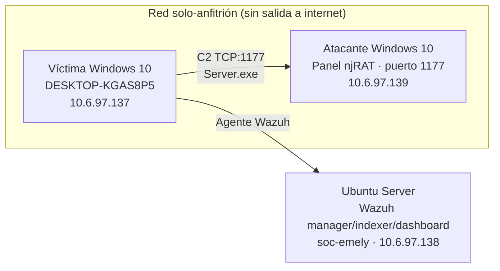

# TSI-303 · Práctica 1 — njRAT y SIEM

Documentación técnica de un laboratorio aislado de infección y detección: se
despliega njRAT en una máquina Windows 10 víctima dentro de una red
solo-anfitrión, y se investiga esa misma infección desde una perspectiva de
Blue Team usando Sysinternals (TCPView, Process Explorer, Autoruns) y un
SIEM (Wazuh).

## Contexto académico

- **Asignatura:** TSI-303 — Hacker Ético II
- **Práctica:** Práctica 1 — Laboratorio njRAT + detección con SIEM
- **Período:** Sep–Dic 2026
- **Modalidad:** Individual, laboratorio propio y aislado
- **Resultado de aprendizaje:** RAE 2 — Explicar las estrategias para proteger un sistema contra malware

## ⚠️ Advertencia de seguridad y alcance

Este laboratorio se ejecutó **exclusivamente en máquinas virtuales propias**,
en una red virtual **solo-anfitrión sin salida a internet ni a redes reales**
(verificado en [`docs/04-configuracion-del-entorno.md`](docs/04-configuracion-del-entorno.md)).
Ejecutar un RAT contra un equipo ajeno o en una red real constituye un delito
bajo la Ley 53-07 de República Dominicana.

Este repositorio **no incluye el binario del RAT, muestras ejecutables, ni
instrucciones de despliegue reutilizables fuera de este alcance autorizado**.
El contenido se centra en análisis, detección y documentación defensiva.

## Propósito de la práctica

Montar y observar una infección por troyano de acceso remoto (RAT) en un
entorno controlado, y luego cazar esa misma infección con las mismas
herramientas que usaría un analista de un centro de operaciones de
seguridad (SOC), cerrando el ciclo con una lectura de la cadena de ataque
y sus contramedidas.

## Objetivo general

Comprender, desde una perspectiva defensiva, cómo investigar una posible
infección, reconocer comportamientos sospechosos, identificar mecanismos
de persistencia, observar conexiones de red y utilizar un SIEM para
recopilar y analizar eventos.

## Objetivos específicos

- Configurar un laboratorio aislado de dos máquinas virtuales y verificar su aislamiento de red.
- Establecer una conexión C2 con njRAT y documentar al menos tres capacidades del RAT.
- Identificar el mecanismo de persistencia dejado por el troyano.
- Detectar la conexión C2 con TCPView y el proceso sospechoso con Process Explorer.
- Confirmar la persistencia con Autoruns.
- Desplegar Wazuh y correlacionar los eventos de ejecución, persistencia y red de la infección.
- Explicar la cadena de ataque del RAT (entrega, ejecución, persistencia, C2, acciones) y sus contramedidas.

## Alcance y limitaciones

- El laboratorio cubre la cadena de infección **desde la ejecución del
  servidor en adelante**; no se documentó un vector de entrega real (phishing,
  descarga), ya que el binario se transfirió manualmente entre VMs.
- La detección se centra en los indicadores de ejecución, persistencia y
  tráfico de red; no se realizó análisis estático ni dinámico profundo del
  binario (PENDIENTE DE VERIFICACIÓN / fuera de alcance de esta práctica).
- La auditoría de Windows y la ingesta en Wazuh se verificaron de forma
  funcional, pero no se documentó la configuración línea por línea de las
  políticas de auditoría ni del `ossec.conf` del agente.

## Tecnologías y herramientas utilizadas

| Categoría | Herramienta |
|---|---|
| Hipervisor | VMware Workstation |
| SO víctima / atacante | Windows 10 Education SP0 x64 |
| SO del SIEM | Ubuntu Server |
| RAT (objeto de estudio) | njRAT v0.7d Golden Edition |
| SIEM | Wazuh (manager + indexer + dashboard) |
| Suite de investigación | Sysinternals: TCPView, Process Explorer, Autoruns |
| Fuente de eventos | Windows Security Auditing (evento 4688) / Sysmon |

## Arquitectura del laboratorio



Ver detalle y evidencia de cada enlace en
[`docs/03-arquitectura-del-laboratorio.md`](docs/03-arquitectura-del-laboratorio.md).

## Componentes verificados

| Componente | SO / Rol | IP | Evidencia |
|---|---|---|---|
| Víctima | Windows 10 Education SP0 x64 — DESKTOP-KGAS8P5 | `10.6.97.137` | [network-isolation/01](evidence/network-isolation/01-ipconfig-victima.png) |
| Atacante | Windows 10 — panel njRAT, puerto 1177 | `10.6.97.139` | [network-isolation/03](evidence/network-isolation/03-ipconfig-atacante.png) |
| SIEM | Ubuntu Server — manager `soc-emely` | `10.6.97.138` | [architecture/01](evidence/architecture/01-wazuh-dashboard-url-ip.png) |
| Agente Wazuh víctima | `DESKTOP-KGAS8P5`, agent.id `004` | `10.6.97.137` | [wazuh/05](evidence/wazuh/05-alerta-conexion-c2-dashboard.png) |

> Nota: un borrador previo de este proyecto asumía agent.id `003` y hostname
> `Windows10-emely`. Las capturas reales muestran agent.id **004** y hostname
> **DESKTOP-KGAS8P5**; se corrige aquí para que la documentación sea fiel a
> la evidencia.

## Metodología de trabajo

1. **Preparación del entorno** — dos VM en red solo-anfitrión, snapshot limpio de la víctima.
2. **Infección observada** — generación del servidor njRAT, conexión C2, demostración de capacidades, identificación de persistencia.
3. **Investigación defensiva con Sysinternals** — TCPView, Process Explorer, Autoruns.
4. **Detección con SIEM** — despliegue de Wazuh, correlación de eventos de ejecución, persistencia y red.
5. **Conclusión defensiva** — cadena de ataque y contramedidas por eslabón.

## Índice de la documentación

| Documento | Contenido |
|---|---|
| [01-introduccion.md](docs/01-introduccion.md) | Motivación y marco de la práctica |
| [02-objetivos-y-alcance.md](docs/02-objetivos-y-alcance.md) | Objetivos detallados y límites del trabajo |
| [03-arquitectura-del-laboratorio.md](docs/03-arquitectura-del-laboratorio.md) | Diagrama y componentes verificados |
| [04-configuracion-del-entorno.md](docs/04-configuracion-del-entorno.md) | Red solo-anfitrión, verificación de aislamiento |
| [05-metodologia.md](docs/05-metodologia.md) | Fases de trabajo y plantilla usada por fase |
| [06-investigacion-defensiva.md](docs/06-investigacion-defensiva.md) | Infección observada y capacidades del RAT |
| [07-sysinternals.md](docs/07-sysinternals.md) | TCPView, Process Explorer, Autoruns |
| [08-wazuh-y-siem.md](docs/08-wazuh-y-siem.md) | Arquitectura y estado de Wazuh |
| [09-evento-4688.md](docs/09-evento-4688.md) | Auditoría de creación de procesos |
| [10-investigacion-de-persistencia.md](docs/10-investigacion-de-persistencia.md) | Clave Run y su confirmación |
| [11-resultados-y-evidencias.md](docs/11-resultados-y-evidencias.md) | Qué se comprobó realmente |
| [12-problemas-y-soluciones.md](docs/12-problemas-y-soluciones.md) | Incidencias durante el laboratorio |
| [13-conclusiones.md](docs/13-conclusiones.md) | Cadena de ataque y contramedidas |
| [14-referencias.md](docs/14-referencias.md) | Fuentes oficiales consultadas |

Evidencias: [`evidence/README.md`](evidence/README.md) ·
Comandos: [`commands/README.md`](commands/README.md) ·
Detecciones: [`detections/`](detections/) ·
Informes: [`reports/executive-summary.md`](reports/executive-summary.md) ·
[`reports/evidence-matrix.md`](reports/evidence-matrix.md)

## Cómo usar este repositorio

```bash
git clone <url-de-tu-repo>
cd tsi-303-njrat-siem
```

Toda la documentación está en Markdown puro; las imágenes están referenciadas
con rutas relativas desde cada documento en `docs/`.

## Licencia

Ver [`LICENSE`](LICENSE). El contenido documental se publica para fines
educativos; no se otorga licencia sobre herramientas de terceros
mencionadas (Wazuh, Sysinternals, njRAT).
