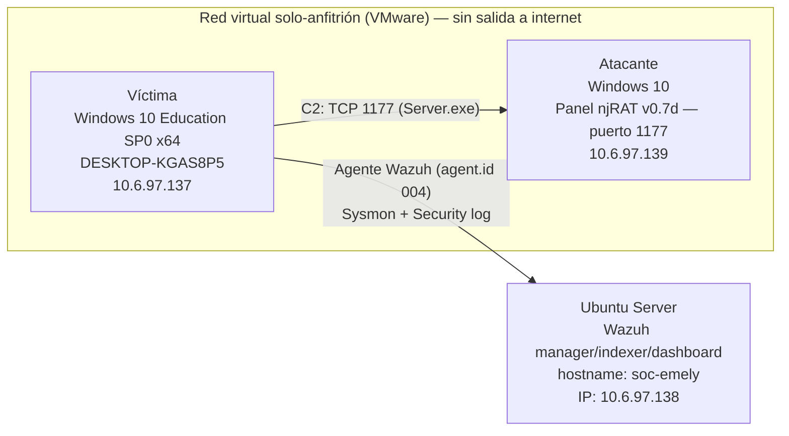

# 03. Arquitectura del laboratorio

## Diagrama

Ver también [`diagrams/lab-architecture.mmd`](../diagrams/lab-architecture.mmd).

## Componentes verificados por evidencia

| Componente | Detalle verificado | Evidencia |
|---|---|---|
| Víctima — interfaz de red | `10.6.97.137` / máscara `255.255.255.0` | [network-isolation/01](../evidence/network-isolation/01-ipconfig-victima.png) |
| Atacante — interfaz de red | `10.6.97.139` / máscara `255.255.255.0` | [network-isolation/03](../evidence/network-isolation/03-ipconfig-atacante.png) |
| Aislamiento de internet (víctima) | `ping 8.8.8.8` → 100% de pérdida | [network-isolation/02](../evidence/network-isolation/02-ping-aislamiento-victima.png) |
| Aislamiento de internet (atacante) | `ping 8.8.8.8` → 100% de pérdida | [network-isolation/04](../evidence/network-isolation/04-ping-aislamiento-atacante.png) |
| Conectividad interna | `ping` entre ambas IP, 0% de pérdida, TTL=128 | mismas capturas anteriores |
| Conexión C2 | TCP `10.6.97.137:50205 → 10.6.97.139:1177 ESTABLISHED`, PID 4912 (`Server.exe`) | [sysinternals/01](../evidence/sysinternals/01-tcpview-server-exe-establecido.png), [sysinternals/02](../evidence/sysinternals/02-netstat-conexion-c2.png) |
| Manager Wazuh | hostname `soc-emely`, servicios `wazuh-manager`, `wazuh-indexer`, `wazuh-dashboard` activos | [wazuh/01-03](../evidence/wazuh/) |
| Dashboard Wazuh — IP del servidor | `10.6.97.138` (vista en la URL del navegador: `https://10.6.97.138/app/threat-hunting#/overview/`) | [architecture/01](../evidence/architecture/01-wazuh-dashboard-url-ip.png) |
| Agente víctima en Wazuh | `DESKTOP-KGAS8P5`, `agent.id: 004` | [wazuh/05](../evidence/wazuh/05-alerta-conexion-c2-dashboard.png) |

## IP del servidor Wazuh — confirmada

La IP del servidor Wazuh es **`10.6.97.138`**, confirmada por la barra de
direcciones del navegador al acceder al dashboard
(`https://10.6.97.138/app/threat-hunting#/overview/`):

Esto completa el cuadro de IPs del laboratorio: víctima `10.6.97.137`,
atacante `10.6.97.139`, servidor Wazuh `10.6.97.138` — las tres máquinas
en el mismo segmento `/24` de la red solo-anfitrión.
