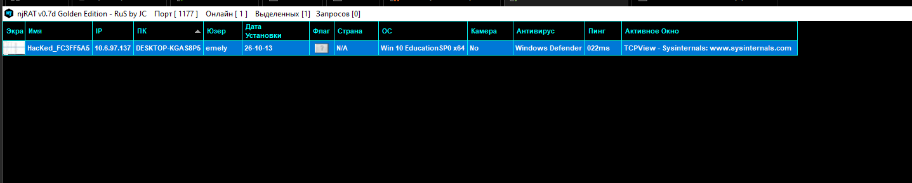
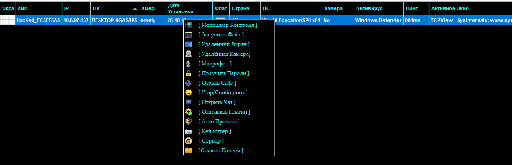
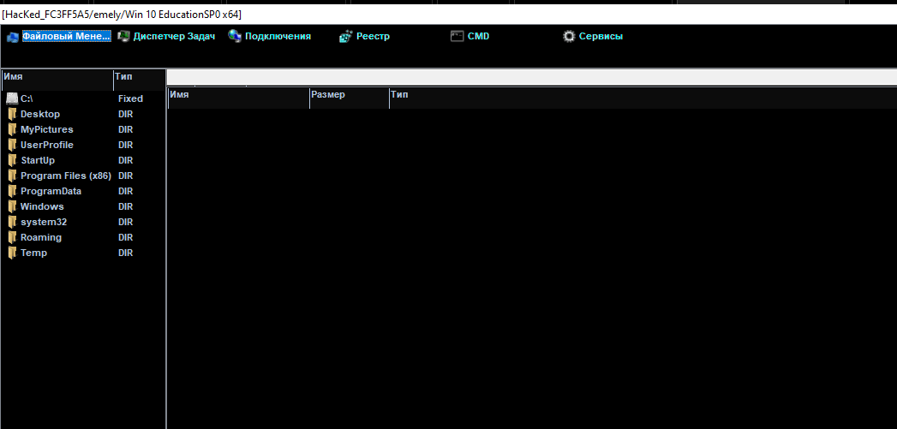
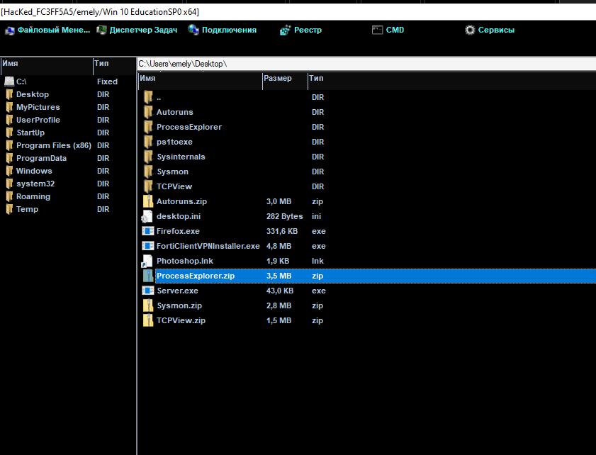
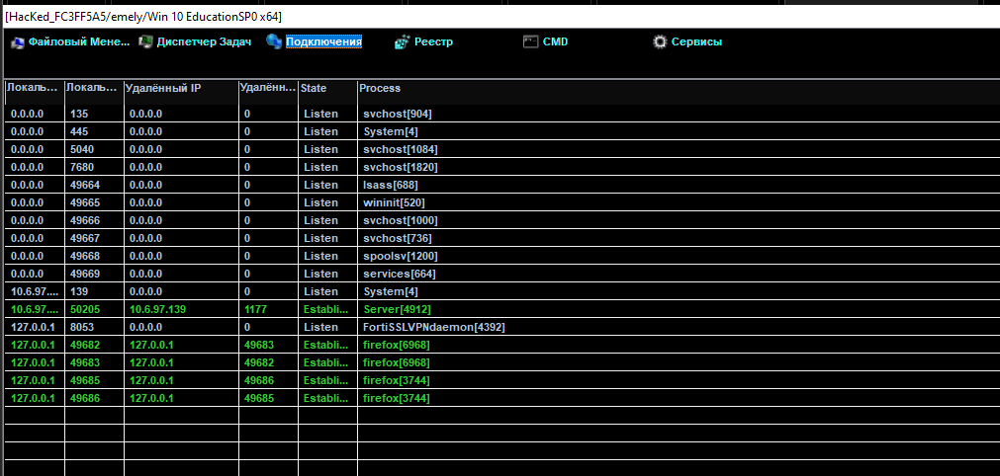
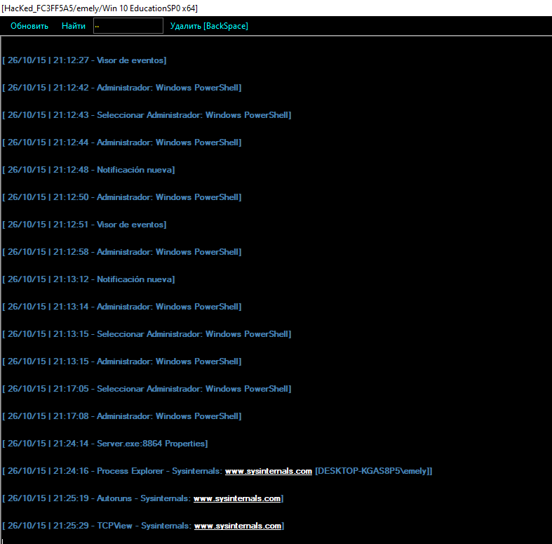

# 06. Infección observada y capacidades del RAT

## Propósito

Montar la infección del lado del atacante y documentar el comportamiento
observable del RAT, como insumo para la fase de detección defensiva.

## Entorno

- Atacante: Windows 10, `10.6.97.139`, panel **njRAT v0.7d Golden Edition**.
- Víctima: Windows 10 Education SP0 x64, `10.6.97.137`, hostname `DESKTOP-KGAS8P5`, usuario `emely`.
- Puerto de escucha configurado en el panel: **1177**.

## Procedimiento

1. Se generó el servidor de njRAT configurado para conectar al puerto 1177
   de la máquina atacante.
2. Se ejecutó el servidor en la víctima, lo que estableció la conexión C2.
3. El panel identificó automáticamente a la víctima con alias
   `HacKed_FC3FF5A5`, reportando hostname, usuario, sistema operativo y
   antivirus detectado (Windows Defender).

### Evidencia — conexión establecida

| Campo reportado por el panel | Valor |
|---|---|
| Hostname | DESKTOP-KGAS8P5 |
| Usuario | emely |
| Sistema operativo | Windows 10 Education SP0 x64 |
| Antivirus detectado | Windows Defender |
| Puerto C2 | 1177 |

## Capacidades demostradas

El menú de control del panel expone múltiples capacidades (explorador de
archivos, pantalla remota, cámara, micrófono, robo de contraseñas,
keylogger, chat, anti-proceso, servicios). Para esta práctica se
demostraron tres, conforme exige el enunciado (no se usó webcam):

### 1. Explorador de archivos remoto

Navegación del sistema de archivos de la víctima desde el panel del
atacante.

### 2. Gestión de archivos / depósito de herramientas

Se usó el mismo explorador remoto para depositar en el escritorio de la
víctima las herramientas de Sysinternals que se usarían después en la fase
defensiva (Autoruns, Process Explorer, TCPView, Sysmon), junto al propio
`Server.exe` (43.0 KB).

### 3. Panel de conexiones TCP del lado del atacante

El panel muestra, desde el lado del atacante, la misma conexión que luego
se confirma con TCPView en la víctima: `Server[4912]` establecido entre
`10.6.97.137:50205` y `10.6.97.139:1177`.

### Registro de actividad en la víctima

Se capturó un registro cronológico de acciones ejecutadas en la víctima
(apertura del Visor de eventos, PowerShell como administrador,
notificaciones), que sirve como línea de tiempo de referencia para
correlacionar después con los eventos vistos en Wazuh.

## Resultado esperado vs. resultado real

**Esperado:** establecer C2 y demostrar como mínimo tres capacidades.
**Real:** C2 establecido en el puerto 1177; demostradas exploración de
archivos, depósito/gestión de archivos y verificación de conexión desde el
panel — cumple el mínimo exigido por el enunciado.

## Interpretación

El comportamiento observado (ejecutable sin firma que abre una conexión
saliente persistente hacia un puerto no estándar, y que permite control
remoto del sistema de archivos) es el patrón exacto que la fase de
detección busca reconocer sin depender del conocimiento previo del alias
"njRAT".

## Limitaciones

No se documentó el vector de entrega (cómo llegaría el binario a una
víctima real); el binario se transfirió manualmente entre VMs para fines
de la práctica.

## Estado: completado
