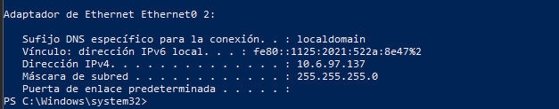
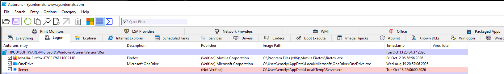
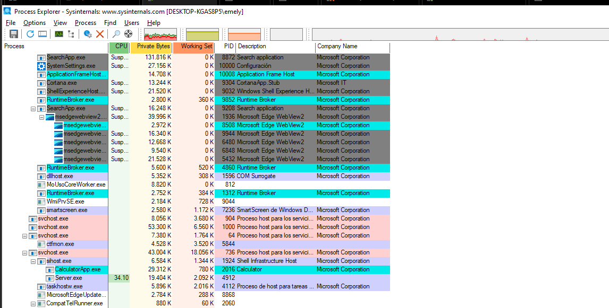

# 07. Investigación defensiva con Sysinternals

## Propósito

Investigar la infección **desde la víctima**, como lo haría un analista sin
conocimiento previo de que el RAT está ahí: localizar la conexión de red
sospechosa, el proceso responsable y su mecanismo de persistencia.

## Entorno

- Víctima: Windows 10 Education SP0 x64, `10.6.97.137`.
- Herramientas: TCPView, Process Explorer, Autoruns (Sysinternals Suite).

## 1. TCPView — identificación de la conexión C2

**Propósito:** localizar la conexión saliente y constante característica
de un RAT ("el latido").



**Resultado real:** entre las conexiones legítimas del sistema
(`svchost.exe`, `lsass.exe`, `firefox.exe`, etc.), se identifica
`Server.exe` (PID 4912) con una conexión **ESTABLISHED** desde
`10.6.97.137:50205` hacia `10.6.97.139:1177`.

Confirmado también por línea de comandos:


```
TCP  10.6.97.137:50205  10.6.97.139:1177  ESTABLISHED  4912
```

Comando usado:

```powershell
netstat -ano | findstr ":1177"
```

**Interpretación:** una conexión saliente persistente hacia una IP interna
no documentada, en un puerto no estándar (1177), iniciada por un proceso
con nombre genérico (`Server.exe`), es un indicador fuerte de C2.

## 2. Process Explorer — el proceso sospechoso

**Propósito:** examinar el árbol de procesos y las propiedades del
ejecutable responsable de la conexión.



**Resultado real:**

| Propiedad | Valor | Señal de sospecha |
|---|---|---|
| Nombre | `Server.exe` | Nombre genérico, no descriptivo |
| PID | 4912 | Coincide con el PID visto en TCPView/netstat |
| Company Name | (vacío) | Todos los procesos legítimos vecinos muestran "Microsoft Corporation" |
| Ubicación | `C:\Users\emely\AppData\Local\Temp\` (confirmado en fase 2 y en Autoruns) | Ruta típica de depósito de malware, no requiere privilegios elevados |

**Interpretación:** la ausencia de editor verificado, combinada con un
nombre genérico y una ruta de ejecución en `%TEMP%`, son tres señales
independientes que por sí solas no prueban nada, pero en conjunto son
suficientes para escalar el proceso a investigación prioritaria.

## 3. Autoruns — confirmación de persistencia

**Propósito:** localizar la entrada de arranque automático que permite al
troyano sobrevivir a un reinicio.



**Resultado real:** en la pestaña *Logon*, bajo
`HKCU\SOFTWARE\Microsoft\Windows\CurrentVersion\Run`, se listan tres
entradas. Dos están verificadas (Mozilla Firefox, Microsoft OneDrive); la
tercera, `Server`, aparece marcada **"(Not Verified)"**, apuntando a
`C:\Users\emely\AppData\Local\Temp\Server.exe`.

Ver desarrollo completo en
[10-investigacion-de-persistencia.md](10-investigacion-de-persistencia.md).

## Resultado esperado vs. resultado real

**Esperado:** localizar, con las tres herramientas, la misma infección
desde tres ángulos distintos (red, proceso, persistencia).
**Real:** las tres herramientas apuntan de forma consistente al mismo
artefacto (`Server.exe`, PID 4912, `%TEMP%`), lo cual es justamente el
valor de triangular evidencia con múltiples fuentes en lugar de confiar en
una sola señal.

## Limitaciones

No se ejecutó un análisis de hash/VirusTotal del binario desde Process
Explorer (columna "VirusTotal" visible pero no consultada en las
capturas disponibles) ni se inspeccionaron DLLs cargadas por el proceso.

## Estado: completado
