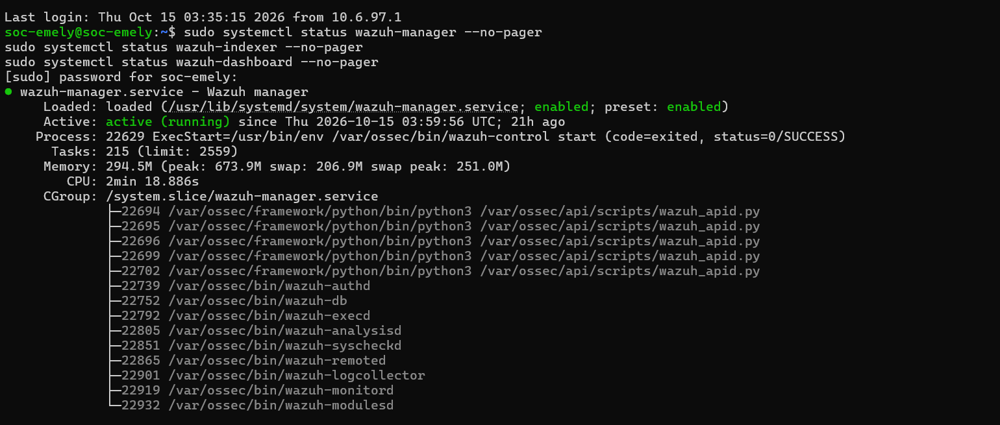
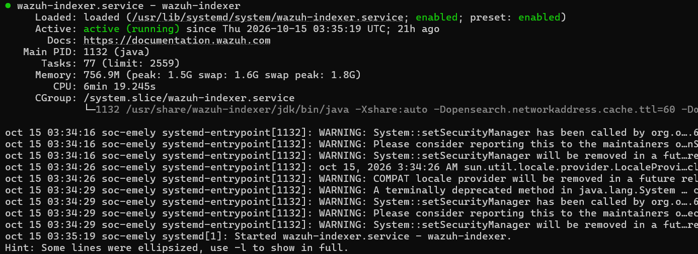
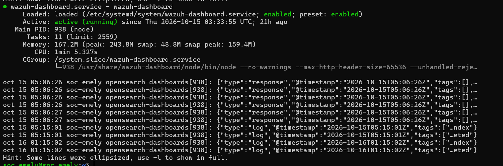
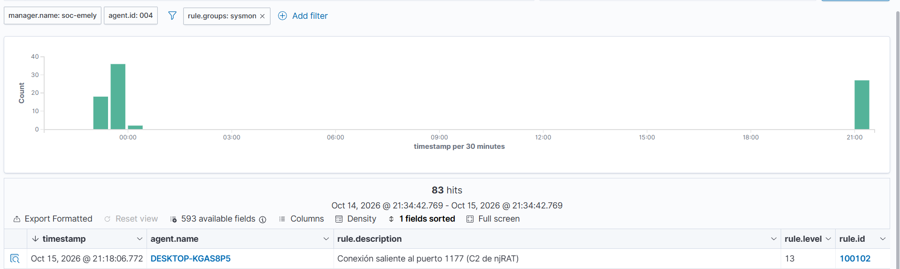
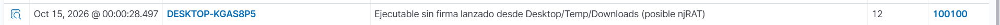

# 08. Wazuh y detección con SIEM

## Propósito

Detectar la misma infección desde la óptica de un SIEM: no mirando la
máquina directamente, sino los eventos que esa máquina reporta a un
sistema central de recolección y correlación.

## Arquitectura de Wazuh en este laboratorio

| Componente | Función | Estado verificado |
|---|---|---|
| `wazuh-manager` | Recibe, decodifica y correla eventos de los agentes; aplica reglas | active (running) |
| `wazuh-indexer` | Almacena e indexa los eventos para búsqueda | active (running) |
| `wazuh-dashboard` | Interfaz web de consulta y visualización | active (running) |
| Agente en la víctima | Recolecta Security log / Sysmon y los envía al manager | Registrado como `DESKTOP-KGAS8P5`, `agent.id: 004` |

## Estado de los servicios

```bash
sudo systemctl status wazuh-manager --no-pager
sudo systemctl status wazuh-indexer --no-pager
sudo systemctl status wazuh-dashboard --no-pager
```



`wazuh-manager.service` activo desde `2026-10-15 03:59:56 UTC`, con los
procesos esperados corriendo: `wazuh-authd`, `wazuh-analysisd`,
`wazuh-syscheckd`, `wazuh-remoted`, `wazuh-logcollector`,
`wazuh-monitord`, `wazuh-modulesd`, además de la API (`wazuh_apid.py`).



`wazuh-indexer.service` activo desde `03:35:19 UTC` (proceso Java, motor
OpenSearch).



`wazuh-dashboard.service` activo desde `03:33:55 UTC`.

**Interpretación:** los tres componentes están arriba y funcionales, lo
que es condición necesaria (pero no suficiente) para que los eventos
generados en la víctima lleguen a ser visibles en el dashboard. El estado
de servicio *no* confirma, por sí solo, que la ingesta de eventos
específicos del RAT esté funcionando — eso se verifica con las alertas
mostradas más abajo.

## Reglas y alertas observadas

Se usaron dos reglas personalizadas sobre eventos tipo Sysmon, asociadas
al patrón de ejecución y de red del RAT:

| rule.id | Descripción | Nivel | Fuente del evento |
|---|---|---|---|
| 100100 | Ejecutable sin firma lanzado desde Desktop/Temp/Downloads (posible njRAT) | 12 | Creación de proceso (equivalente a 4688 / Sysmon Event ID 1) |
| 100102 | Conexión saliente al puerto 1177 (C2 de njRAT) | 13 | Conexión de red (Sysmon Event ID 3) |

### Alerta 100100 — ejecución del payload



```
Oct 15, 2026 @ 00:00:28.497 | DESKTOP-KGAS8P5 |
Ejecutable sin firma lanzado desde Desktop/Temp/Downloads (posible njRAT) |
nivel 12 | rule.id 100100
```

**Fundamento técnico de la regla:** dispara cuando el evento de creación de
proceso reporta un binario sin firma digital, ejecutado desde una de las
rutas típicas de depósito de malware (Desktop, Temp, Downloads) — patrón
que coincide con `Server.exe` en `%TEMP%`.

### Alerta 100102 — conexión al C2



```
Oct 15, 2026 @ 21:18:06.772 | DESKTOP-KGAS8P5 |
Conexión saliente al puerto 1177 (C2 de njRAT) |
nivel 13 | rule.id 100102
```

**Vista agregada:** filtrando por `agent.id: 004` y `rule.groups: sysmon`
se observan **83 hits** en la ventana de 24 horas consultada, con un pico
de actividad concentrado antes de la medianoche (coincidente con la
ventana de infección) y un evento aislado posterior (~21:18), coherente
con una reconexión del RAT durante la sesión de pruebas documentada en
este repositorio.

## Diferencia entre un evento recolectado y una detección confirmada

Es importante distinguir tres niveles:

1. **Evento generado localmente** (en el log de Seguridad de Windows o en
   Sysmon) — ocurre en la víctima, independientemente de si algo lo lee.
2. **Evento recolectado por el agente y visible en Wazuh** — requiere que
   el agente esté activo, la fuente configurada, y la conectividad
   agente→manager funcionando.
3. **Alerta generada por una regla** — requiere, además, que exista una
   regla que reconozca el patrón del evento como sospechoso.

En este laboratorio se confirmaron los tres niveles para los dos
indicadores documentados (ejecución y red), porque existen capturas del
dashboard mostrando las alertas con su `rule.id`, no solo del log crudo.

## Resultado esperado vs. resultado real

**Esperado:** ver en el SIEM la creación del proceso del troyano, el
cambio en la clave `Run`, y si el SIEM captura red, la conexión saliente.
**Real:** se confirmaron la creación del proceso (100100) y la conexión
saliente (100102). La alerta específica sobre el cambio en la clave `Run`
no se persiguió como evidencia independiente para esta entrega.

## Limitaciones

- No se documentó el contenido exacto de la regla personalizada (XML de
  `local_rules.xml`) usada para generar las alertas 100100/100102.
- No se verificó explícitamente en captura si Wazuh está ingiriendo el
  canal Sysmon Operational completo o solo el log de Seguridad de Windows
  con auditoría de procesos habilitada.

## Estado: completado
