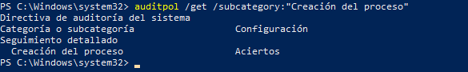

# 09. Evento de seguridad 4688 y Sysmon

## Qué es el evento 4688

El evento 4688 de Windows Security ("A new process has been created") se
genera cuando la auditoría de creación de procesos está habilitada
(`Audit Process Creation`). Registra, entre otros campos, el nombre del
nuevo proceso, su PID, el proceso padre y, opcionalmente, la línea de
comandos usada para lanzarlo.

## Diferencia entre Sysmon y el registro de seguridad de Windows

| Aspecto | Windows Security (4688) | Sysmon |
|---|---|---|
| Origen | Subsistema de auditoría nativo de Windows | Driver/servicio de Microsoft Sysinternals, instalación aparte |
| Detalle del evento | Básico: proceso, PID, padre, línea de comandos (si se habilita) | Mucho más rico: hash del binario, GUID de proceso, firma digital, conexiones de red (Event ID 3), creación de archivos, etc. |
| Requiere instalación adicional | No (solo habilitar política de auditoría) | Sí |

En este laboratorio se usaron ambas fuentes de forma complementaria: el
concepto de auditoría de creación de procesos (4688) como marco teórico
exigido por el enunciado, y Sysmon como la fuente real de los eventos que
alimentan las reglas 100100/100102 en Wazuh (ver
[08-wazuh-y-siem.md](08-wazuh-y-siem.md)).

## Diferencia entre generación de eventos y generación de alertas

Que el evento 4688/Sysmon ID 1 se genere en la víctima no implica que
exista una alerta. La alerta requiere una **regla** que interprete ese
evento como sospechoso (en este caso, por la combinación de "sin firma" +
"ruta típica de malware").

## Consideración de privacidad

El evento 4688 puede incluir la línea de comandos completa del proceso si
se habilita `Include command line in process creation events`. Esta
información puede contener rutas de usuario, nombres de archivo y, en
algunos casos, credenciales pasadas como argumento. Por ese motivo, este
repositorio **no publica líneas de comandos completas capturadas del log
de seguridad** más allá de lo ya visible en las capturas de pantalla
documentadas en otras secciones.

## Estado de verificación en este laboratorio

| Afirmación | Estado |
|---|---|
| La auditoría de creación de procesos estaba activa en la víctima | **Confirmado** — ver evidencia abajo |
| Sysmon estaba instalado y generando eventos | Confirmado indirectamente: existe la carpeta `Sysmon` en el escritorio de la víctima ([rat-panel/04](../evidence/rat-panel/04-explorador-remoto-herramientas.png)) y las reglas 100100/100102 en Wazuh están etiquetadas `rule.groups: sysmon` |
| Los eventos llegaron al manager de Wazuh | Confirmado — alertas visibles en el dashboard con `rule.id` y `agent.name: DESKTOP-KGAS8P5` |

## Evidencia — auditoría de creación de procesos activa

```powershell
auditpol /get /subcategory:"Creación del proceso"
```



```
Directiva de auditoría del sistema
Categoría o subcategoría          Configuración
  Seguimiento detallado
  Creación del proceso            Aciertos
```

**Interpretación:** la subcategoría "Creación del proceso" tiene la
auditoría de **Aciertos** (Success) habilitada, lo que confirma que
Windows genera el evento 4688 cada vez que se crea un nuevo proceso en la
víctima — condición necesaria para que tanto el log de Seguridad nativo
como el pipeline Sysmon → Wazuh puedan capturar la ejecución de
`Server.exe`.

## Estado: completado
