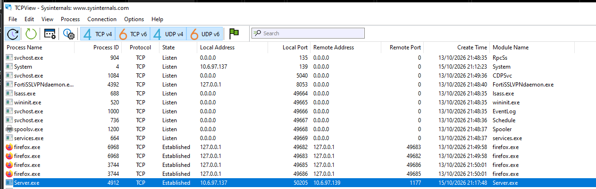

# 10. Investigación de persistencia

## Propósito

Confirmar, por al menos dos métodos independientes, el mecanismo que
permite al troyano sobrevivir a un reinicio del sistema.

## Resultado — confirmado por Autoruns


| Campo | Valor |
|---|---|
| Ubicación | `HKCU\SOFTWARE\Microsoft\Windows\CurrentVersion\Run` |
| Nombre de la entrada | `Server` |
| Publisher | **(Not Verified)** |
| Ruta de imagen | `C:\Users\emely\AppData\Local\Temp\Server.exe` |
| Timestamp | `Tue Oct 13 22:06:00 2026` |

Comparado con las otras dos entradas en la misma clave (`Mozilla-Firefox`,
`OneDrive`), ambas marcadas como verificadas y publicadas por editores
reconocidos, la entrada `Server` es la única sin firma y la única que
apunta a una carpeta temporal del perfil de usuario.

## Resultado — confirmado por consulta directa al registro



```powershell
reg query "HKCU\Software\Microsoft\Windows\CurrentVersion\Run"
```

```
HKEY_CURRENT_USER\Software\Microsoft\Windows\CurrentVersion\Run
    OneDrive                        REG_SZ    "C:\Users\emely\AppData\Local\Microsoft\OneDrive\OneDrive.exe" /background
    Mozilla-Firefox-E7CF176E110C211B REG_SZ    "C:\Program Files (x86)\Mozilla Firefox\firefox.exe" -os-autostart
    Server                          REG_SZ    C:\Users\emely\AppData\Local\Temp\Server.exe
```

Ambos métodos coinciden exactamente en la ruta y el nombre de la entrada,
lo que elimina la posibilidad de que se trate de un artefacto o error de
una sola herramienta.

## Interpretación

- La persistencia se da a nivel de **usuario** (`HKCU`, no `HKLM`), lo cual
  es consistente con que `Server.exe` se ejecutó sin elevación de
  privilegios.
- El uso de la clave `Run` es uno de los mecanismos de persistencia más
  básicos y más fáciles de detectar — precisamente por eso Autoruns lo
  reconoce de inmediato sin necesidad de reglas personalizadas.

## Limitaciones

No se investigó si existían mecanismos de persistencia adicionales
(tareas programadas, servicios, WMI event subscriptions) más allá de la
clave `Run`; Autoruns los habría mostrado en otras pestañas (*Scheduled
Tasks*, *Services*) pero no hay captura de esas pestañas en el material
disponible.

## Estado: completado (clave Run); otras vías de persistencia no exploradas
